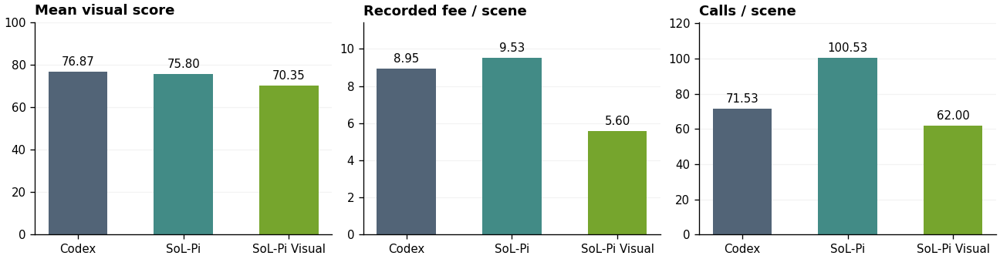
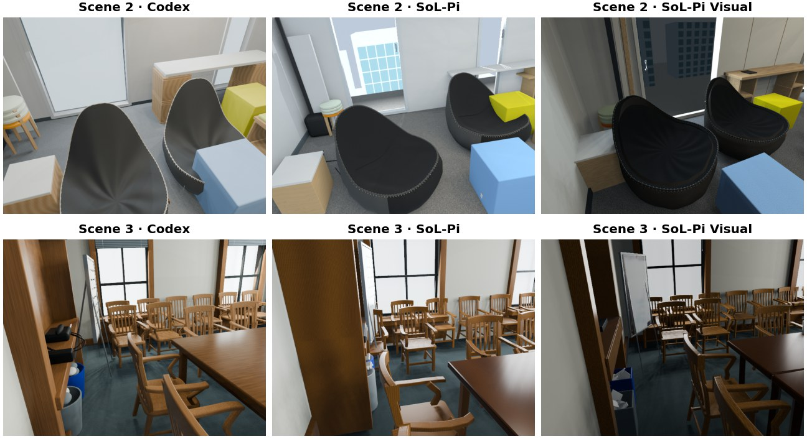

# SoL-Pi Visual

This example extends SoL-Pi for visual scene reconstruction. It supports
image-detail inspection, targeted scene refinement, and more efficient workflows.

## Usage

Requirements: the parent repository's Node.js dependencies, Python 3.10+,
and Blender for scene reconstruction.

From the SoL-Pi repository root:

```bash
npm ci --ignore-scripts
export SOLPI_ROOT="$PWD"
python3 -m venv "$SOLPI_ROOT/.pi/visual-venv"
source "$SOLPI_ROOT/.pi/visual-venv/bin/activate"
python -m pip install Pillow==11.3.0
```

In your scene project, create `.pi/solpi-visual.json` with the following settings.
If the file already exists, update its switches instead of replacing it.

```json
{
  "version": 1,
  "localEditScope": true,
  "magnify": true,
  "awaitRender": true
}
```

Start Pi from that project, keeping the Python environment active:

```bash
cd /path/to/scene-project
"$SOLPI_ROOT/node_modules/.bin/pi" --approve \
  --extension "$SOLPI_ROOT/src/sol-pi/index.ts" \
  --extension "$SOLPI_ROOT/examples/solpi-visual/src/index.ts"
```

`--approve` trusts the project; use it only for projects you trust. Configure the
base SoL-Pi features using the [root README](../../README.md), and select your model
and authentication through Pi. Tested with Pi 0.85.1.

Give the agent a reference video or images and a task, for example:

> Reconstruct the room from reference.mp4 in Blender. Save scene.blend and render
> a camera walkthrough. Compare the renders with the reference, inspect unclear
> regions with magnify, and refine the scene.

| Setting | Effect |
| --- | --- |
| `localEditScope` | Focus each edit on one visual discrepancy while keeping the whole-scene requirements. |
| `magnify` | Crop a reference image or render for closer inspection. |
| `awaitRender` | Wait for render/build results when there is no independent work, reducing polling-only turns. |

All switches default to `false`. They only take effect in a trusted project;
restart Pi after changing them. Settings stay in `solpi-visual.json`, separate
from the base `sol-pi.json`. Crop files are stored under Pi's session directory
in `sol-pi-examples/solpi-visual/`; temporary sessions use a private temp directory.

A `magnify` call uses pixel coordinates `[left, top, right, bottom]`:

```json
{"image":"renders/front.png","bbox":[120,80,260,240],"scale":2}
```

For paired inspection, add `reference` and `referenceBbox`. Inputs must be PNG/JPEG;
the default output edge limit is 1024 pixels.

## 15-scene results

We compare Codex, SoL-Pi, and SoL-Pi Visual (three settings above enabled)
using **GPT-6 Astra** with high reasoning effort on 15 scenes from
[VSI-Bench](https://huggingface.co/datasets/nyu-visionx/VSI-Bench):
five each from ARKitScenes, ScanNet++ and ScanNet.

Average model-graded visual scores, recorded fees and call counts across 15 scenes.



Reconstructions of Scene 2 and Scene 3 by Codex, SoL-Pi and SoL-Pi Visual.


